# Vektor Architecture

This page explains how Vektor is put together, for developers who are new to the codebase. It is based on the code as of **2026-11-24**. Diagrams are [Mermaid](https://mermaid.js.org/) and render on GitHub, GitLab, and in VS Code with a Mermaid preview extension.

> **Reading guide.** Some modules exist and are exposed through their own endpoints but are **not yet on the chat path**. They are marked with a status in [section 11](#11-what-is-wired-in-and-what-is-not). Do not assume a feature is enforced just because its module exists.

**Contents**

1. [System context](#1-system-context)
2. [Backend layers](#2-backend-layers)
3. [Module map](#3-module-map)
4. [A chat turn, end to end](#4-a-chat-turn-end-to-end)
5. [Knowledge and RAG](#5-knowledge-and-rag)
6. [Identity, tenancy, and access](#6-identity-tenancy-and-access)
7. [Data model](#7-data-model)
8. [Workflows](#8-workflows)
9. [Frontend](#9-frontend)
10. [Deployment](#10-deployment)
11. [What is wired in and what is not](#11-what-is-wired-in-and-what-is-not)
12. [Where to look in the code](#12-where-to-look-in-the-code)

---

## 1. System context

Vektor is a FastAPI backend plus a Next.js web app. People use the web app. Chat tools and automations can also reach the backend directly. The backend talks to an OpenAI-compatible LLM provider and stores everything in SQL.

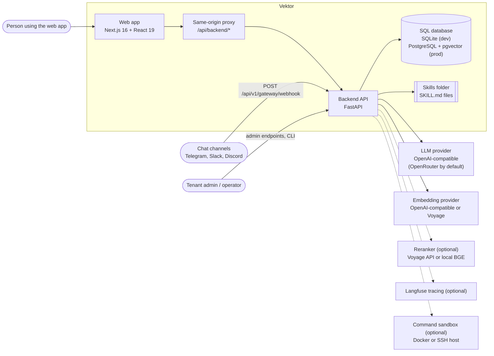

Solid arrows are always used. Dashed arrows are optional and turned on through settings.

---

## 2. Backend layers

Code lives under `src/`. Requests move top to bottom. Each layer only calls the layer below it.

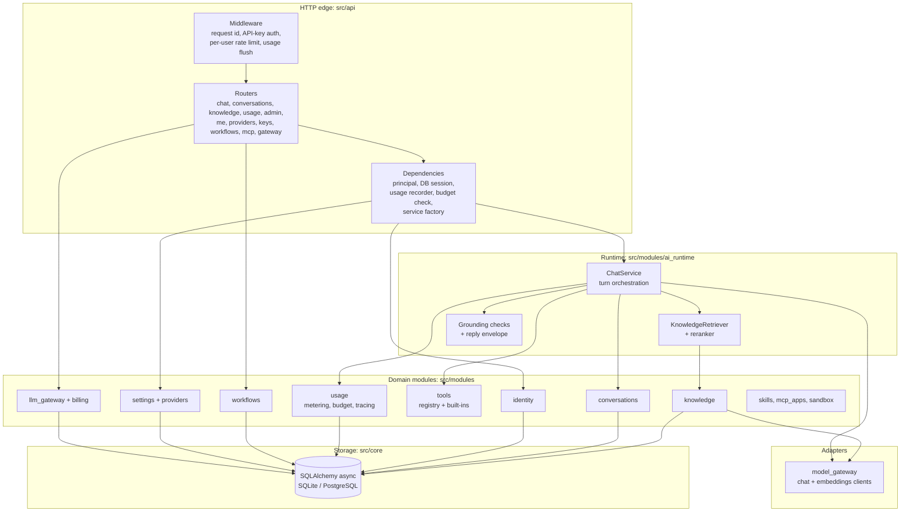

**Conventions that hold across the backend**

- A module usually has `models.py` (tables), `repository.py` (queries), and `schemas.py` (Pydantic types).
- **Repositories receive the caller's `Principal`** and add tenant and owner filters themselves. Routers should never build such filters by hand.
- Routers stay thin: validate input, call a repository or service, map errors to HTTP codes.
- All settings are environment variables prefixed `VEKTOR_`, validated in `src/core/config/settings.py`.

---

## 3. Module map

| Module (`src/modules/…`) | Responsibility |
|---|---|
| `ai_runtime` | `ChatService` (one chat turn), retrieval, reranking, grounding verification, reply envelope, system prompt |
| `knowledge` | Document ingestion (extract, chunk, embed), hybrid search, per-document visibility and grants |
| `conversations` | Conversations and messages, history token budgeting, compaction into a summary |
| `identity` | `Principal` (user, tenant, roles), API keys (stored hashed), audit log |
| `model_gateway` | OpenAI-compatible chat client (streaming, tool-call fragments), embeddings clients |
| `usage` | Metering of every model call, tenant monthly token budget, tool usage and feedback, optional Langfuse tracing |
| `tools` | Tool registry with a risk gate, built-in tools, result cache |
| `workflows` | Multi-step workflows with human approval checkpoints |
| `settings`, `providers` | Per-user provider selection and profiles, model discovery |
| `llm_gateway` | Bring-your-own-key vault (envelope encryption), tenant key policy, SSRF guard, model registry |
| `billing` | Credit ledger with reserve, settle, and release holds |
| `skills` | `SKILL.md` discovery and a catalogue injected into the prompt |
| `mcp_apps` | Registry of interactive HTML widgets (`ui://` resources) |
| `sandbox` | Isolated command execution backends (disabled, Docker, SSH) |

---

## 4. A chat turn, end to end

This is the streaming path, `POST /api/v1/chat/stream`. The non-streaming `POST /api/v1/chat` runs the same steps and returns one JSON body.

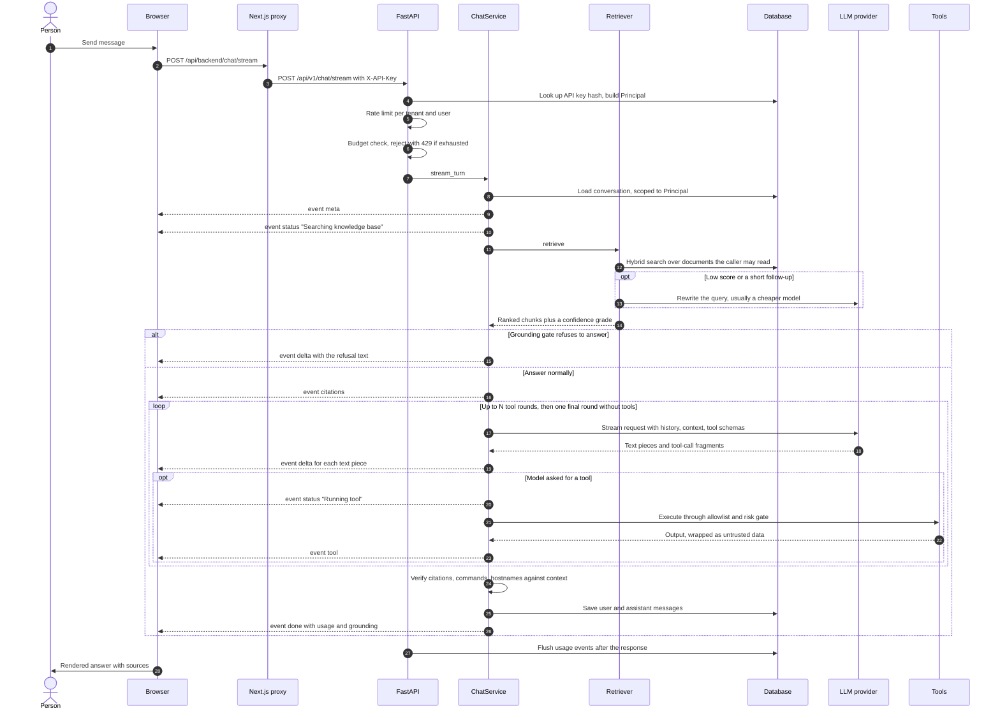

**Things worth knowing**

- **Events** sent to the browser: `meta`, `status`, `citations`, `tool`, `reasoning`, `delta`, `done`, `error`. Their shape is `ChatStreamEvent` in `src/modules/ai_runtime/schemas.py`.
- **Stop button.** If the browser disconnects mid-answer, `src/api/streaming.py` saves the text already sent with a `(Stopped)` marker. If no text was sent yet, nothing is saved.
- **Errors during streaming** become an `error` event, not a broken HTTP response, because the `200` status is already sent.
- **Usage events** are collected in memory during the request and written after the response, so metering never blocks or breaks a chat.
- **Tool output is untrusted.** It is fenced in `<tool_output>` tags and capped, so text inside a tool result cannot act as an instruction.

---

## 5. Knowledge and RAG

### 5.1 Ingestion

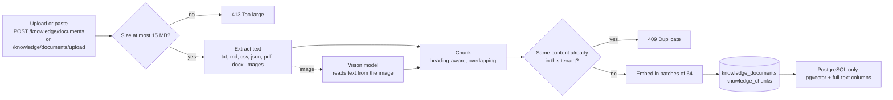

- Files are read in 1 MB pieces and rejected as soon as they pass the limit. PDFs over 500 pages are refused. PDF and DOCX parsing runs off the event loop.
- Every document records its **owner, tenant, and visibility** (`private`, `tenant`, or `shared` with grants). See [section 6](#6-identity-tenancy-and-access).
- Embedding and vision calls are metered like chat calls.

### 5.2 Retrieval

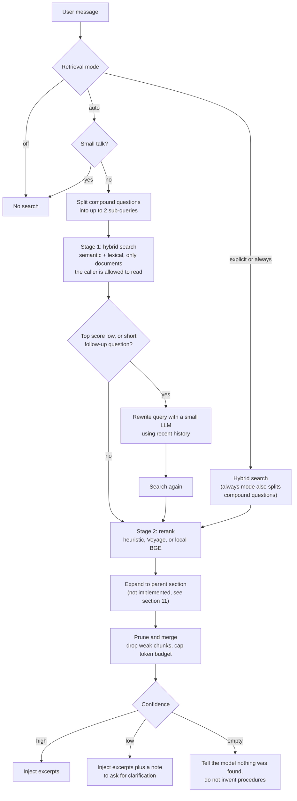

- **SQLite** (development) computes cosine similarity in Python over embeddings stored as JSON. This is fine for small knowledge bases and slow for large ones.
- **PostgreSQL** (production) uses `pgvector` and full-text search in SQL (migration `0006`).
- Only chunks embedded with the **currently configured embedding model** are compared.
- The reranker is chosen by settings: a zero-latency heuristic, the Voyage rerank API, or a local cross-encoder.
- Each excerpt carries a freshness note when its document has not been updated for `retrieval_stale_days`.

---

## 6. Identity, tenancy, and access

Every request is resolved to a `Principal` (user id, tenant id, roles) by the auth middleware. Repositories use it to filter everything they read.

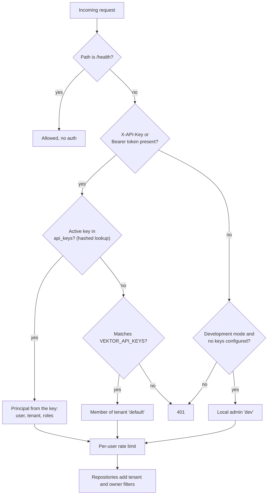

**Access rules**

| Resource | Who can read | Who can change or delete |
|---|---|---|
| Conversation | Its owner. A tenant admin can also open it, and that access is **audited** | Owner. A tenant admin can delete, audited |
| Document `private` | Owner only | Owner or tenant admin (audited) |
| Document `tenant` | Everyone in the tenant | Owner or tenant admin |
| Document `shared` | Owner and users with a grant | Owner or tenant admin |
| Usage numbers | The user sees their own. Admins see the whole tenant | n/a |
| Tenant budget | Everyone in the tenant | Admin only |

- Anything in another tenant, or not visible to you, returns **404**, not 403, so its existence is not revealed. A readable-but-not-yours resource returns 403 when you try to change it.
- Tenant admins can manage a document without being able to read a private one.
- **Three different kinds of keys exist. Do not mix them up.**

  | Key | Table | Purpose |
  |---|---|---|
  | Vektor API key | `api_keys` | Identifies a caller to this backend. Stored as a SHA-256 hash. Create with `python -m api.cli create-key`. |
  | Provider key (BYOK) | `provider_keys` | A tenant's own LLM provider credential, envelope-encrypted and bound to its tenant. |
  | Platform key | `platform_keys` | Pooled credentials used when a tenant is on the managed plan. |

See [`multi-user-design.md`](multi-user-design.md) for the reasoning behind these rules.

---

## 7. Data model

There is **no `tenants` or `users` table**. `tenant_id` and `user_id` are plain strings carried on every row, and the `Principal` supplies them. Relationship lines below are real foreign keys. Everything else is joined by `tenant_id` and `user_id` in queries.

### 7.1 Conversations and knowledge

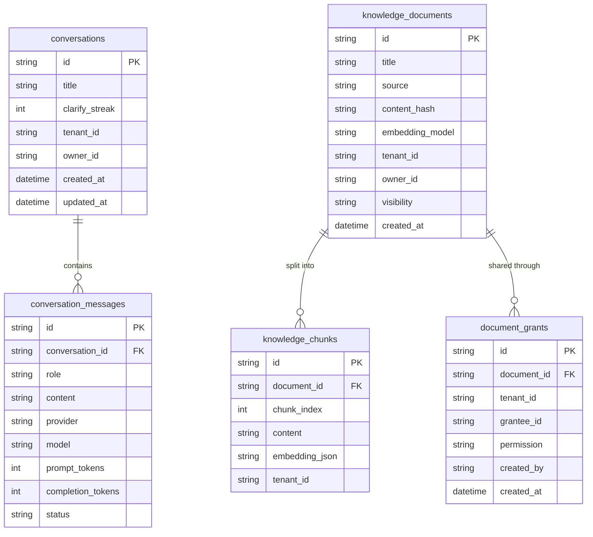
_Subset of columns:_ `conversation_messages` (9 of 12 columns shown).

### 7.2 Identity, usage, and billing

```mermaid
erDiagram

    api_keys {
        string id PK
        string tenant_id
        string user_id
        string key_hash
        string roles
        string label
        datetime created_at
        datetime expires_at
        datetime revoked_at
    }
    audit_logs {
        string id PK
        string tenant_id
        string actor_id
        string action
        string resource_type
        string resource_id
        string resource_owner_id
        datetime created_at
    }
    usage_events {
        string id PK
        string tenant_id
        string user_id
        string kind
        string provider
        string model
        int prompt_tokens
        int completion_tokens
        int total_tokens
    }
    tool_usage_events {
        string id PK
        string tenant_id
        string user_id
        string tool_name
        string status
        int duration_ms
        datetime created_at
    }
    message_feedback {
        string id PK
        string tenant_id
        string user_id
        string conversation_id
        string message_id
        string rating
        string comment
        datetime created_at
    }
    tenant_budgets {
        string tenant_id PK
        int monthly_token_limit
        float warn_ratio
        datetime updated_at
    }
    platform_keys {
        string id PK
        string provider
        string label
        string ciphertext
        string wrapped_dek
        string status
        int monthly_limit_micros
        datetime created_at
    }
    credit_ledger {
        string id PK
        string tenant_id
        string entry_type
        int amount_micros
        string ref_id
        datetime created_at
    }
    credit_reservations {
        string id PK
        string tenant_id
        int hold_micros
        string status
        datetime expires_at
        datetime created_at
    }
```
_Subset of columns:_ `usage_events` (9 of 10 columns shown).

### 7.3 Workflows and provider configuration

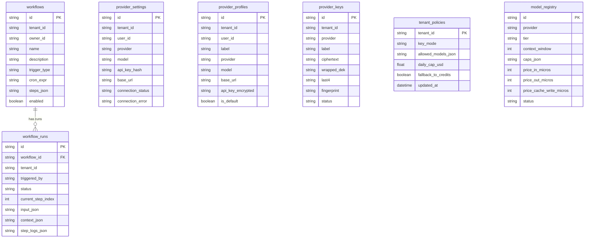
_Subset of columns:_ `workflows` (9 of 11 columns shown), `workflow_runs` (9 of 12 columns shown), `provider_settings` (9 of 13 columns shown), `provider_profiles` (9 of 11 columns shown), `provider_keys` (9 of 11 columns shown), `model_registry` (9 of 13 columns shown).

Schema changes go through Alembic migrations in `migrations/versions/` (see [section 11](#11-what-is-wired-in-and-what-is-not) for a problem with the current chain).

---

## 8. Workflows

A workflow is an ordered list of steps with a trigger (`manual`, `webhook`, or `cron`). The runner executes steps in order and can **pause for a human decision**.

| Step type | What it does |
|---|---|
| `knowledge_search` | Searches the knowledge base |
| `llm_step` | Calls the model with a prompt template |
| `tool_call` | Runs a registered tool through the same allowlist as chat |
| `human_approval` | Stops the run until someone approves or rejects it |

Steps can use earlier results through templates such as `{{ input.x }}` and `{{ steps.<step id>.output }}`.

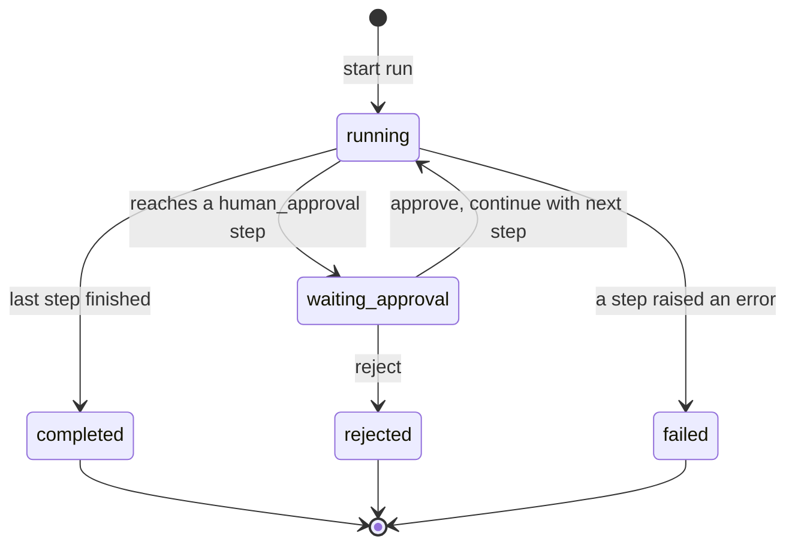

Each run stores its step logs and context as JSON in `workflow_runs`, so a paused run can be resumed later, even after a restart.

---

## 9. Frontend

The web app is one client-side screen (`VektorApp`) that switches between views. It never talks to the backend directly. Every call goes through a Next.js route handler, which checks the destination and forwards the request.

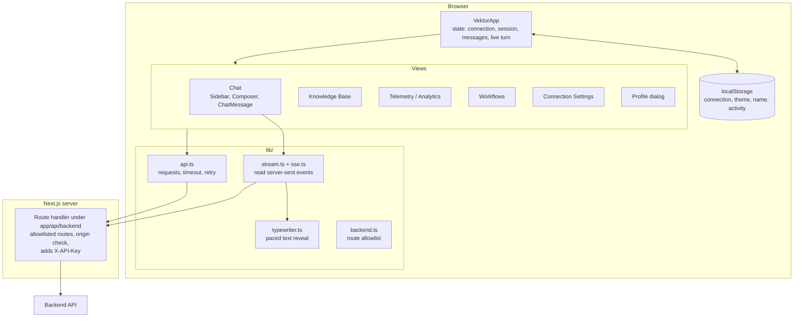

- **Why a proxy.** The API key and backend URL live in the browser, but requests are same-origin. The route handler only forwards paths listed in `lib/backend.ts` and only to the configured origin or `VEKTOR_ALLOWED_BACKEND_ORIGINS`.
- **Streaming UI.** `stream.ts` parses events and the typewriter reveals text at an adaptive pace, with a thinking indicator and live status before the first word. Pressing Stop (or Esc) aborts the request.
- **No backend session.** Authentication is the API key sent with every request. There is no cookie session.
- Tests: Vitest for `lib/`, Playwright for end-to-end flows in `frontend/e2e/`.

---

## 10. Deployment

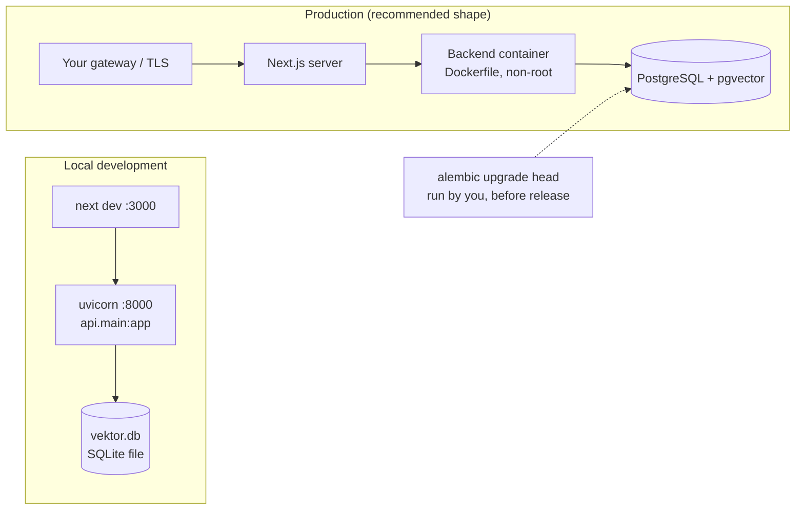

- The **Dockerfile builds the backend only**. It does not contain the web app, the Alembic migrations, or the `docs` folder. Run migrations from a checkout, and deploy the frontend separately.
- Outside `development`, startup **fails** unless `VEKTOR_API_KEYS` is set. In `production`, it also fails if debug is on, and the API docs are turned off.
- The default SQLite file is for local use. Use PostgreSQL for anything shared.
- Not hardened for direct internet exposure. Put it behind your own gateway.

---

## 11. What is wired in and what is not

This table was produced by checking which code actually calls each piece, not by reading intentions.

| Capability | State | Notes |
|---|---|---|
| API-key auth, per-user rate limit, tenant and owner scoping | **On the chat path** | Applies to every authenticated route |
| Monthly tenant token budget | **On the chat path** | `require_budget` dependency on chat routes, `429` when exhausted |
| Usage metering (chat, rewrite, embedding, vision) | **On the chat path** | Written after the response |
| Hybrid retrieval, conditional rewrite, rerank, prune, confidence grading | **On the chat path** | |
| Grounding checks and the refusal gate | **On the chat path** | |
| Tool registry, risk gate, result cache | **On the chat path** | Built-ins include two mutating tools, blocked unless explicitly allowed |
| Per-user provider profiles | **On the chat path** | Resolved per turn |
| Skills catalogue in the prompt | **On the chat path** | |
| Conversation compaction | **Own endpoint** | `POST /conversations/{id}/compact` |
| Workflows | **Own endpoints** | `/api/v1/workflows` |
| MCP Apps widgets | **Own endpoints** | `/api/v1/mcp` |
| Messaging gateway | **Own endpoint** | Calls `ChatService`, so it shares the chat path |
| BYOK vault, tenant key policy, credit ledger, SSRF guard | **Own endpoints only** | `keys.py` uses them. **Chat calls do not resolve keys through `KeyResolver` and do not reserve or settle credits.** |
| Model registry (capability gating, versioned pricing) | **Not used by the app** | `ModelRegistryService` is only exercised by unit tests |
| Command sandbox | **Opt-in** | A disabled backend is the safe default. Docker and SSH are selected in settings. The tool is mutating |
| Parent-section expansion in retrieval | **Not implemented** | The retriever calls `expand_parent_sections` only if it exists, and no repository defines it, so this step is silently skipped |

**Known problems found while writing this page**

1. **Alembic has two heads.** `0008_tenant_budgets` and `0008_workflow_cron` both descend from `0007_workflows`, and `0009` continues from only one of them. `alembic upgrade head` will refuse to run until the branches are merged or re-chained.
2. **Parent expansion** (above) is a no-op until `expand_parent_sections` exists.
3. **Credits and BYOK are not enforced on chat.** If you advertise either, wire `KeyResolver` and `CreditLedgerService` into the provider used by `ChatService` first.

---

## 12. Where to look in the code

| If you want to… | Start here |
|---|---|
| Add an endpoint | `src/api/routers/`, then register it in `src/api/main.py` |
| Change how a chat turn works | `src/modules/ai_runtime/service.py` |
| Change retrieval or ranking | `src/modules/ai_runtime/retriever.py`, `reranker.py`, `src/modules/knowledge/repository.py` |
| Change how documents are split | `src/modules/knowledge/chunker.py`, `extractors.py` |
| Add a built-in tool | `src/modules/tools/builtins.py` (set `risk_level="mutating"` for anything that changes state) |
| Change auth or roles | `src/api/auth.py`, `src/modules/identity/` |
| Add a table | A `models.py`, a new migration in `migrations/versions/`, and the model import in `src/api/main.py` and `migrations/env.py` |
| Add a setting | `src/core/config/settings.py` and `.env.example` |
| Change the UI shell | `frontend/components/vektor-app.tsx` |
| Change how the UI calls the backend | `frontend/lib/api.ts`, `stream.ts`, and `frontend/app/api/backend/` |
| See what is tested | `tests/unit/` (no database) and `tests/integration/` (in-memory SQLite) |

Related documents: [`README.md`](../README.md), [`scope.md`](../scope.md), [`multi-user-design.md`](multi-user-design.md), [`plan-close-gaps.md`](plan-close-gaps.md).
